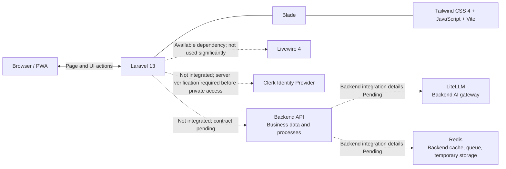

# 01 — Technology Stack dan Kepemilikan

## 1. Stack resmi

| Teknologi | Peran yang ditetapkan | Pemilik dan batas |
|---|---|---|
| Laravel 13 | Routing, Blade rendering, response headers, dan serving halaman | Digunakan sekarang; sesi autentikasi operasional belum tersedia |
| Livewire 4 | Dependency tersedia untuk UI server-driven | Directive assets tersedia pada layout; halaman yang diaudit memakai Vanilla JavaScript untuk interaksi dan belum menggunakan komponen Livewire secara signifikan |
| Blade | Template, layout, markup semantik, dan komponen view reusable | Mekanisme utama rendering halaman saat ini; bukan batas authorization |
| Tailwind CSS 4 | Styling, responsive variants, dan design utilities | Digunakan melalui plugin Vite dan stylesheet utama |
| Vanilla JavaScript (ES modules) | Interaksi browser, filter/pagination DEMO, preferensi, profil demo, locale, drawer, dan PWA events | Banyak modul halaman berjalan di browser; business state tetap bukan sumber operasional |
| Vite | Bundling aset CSS/JavaScript | Entry saat ini `resources/css/app.css` dan `resources/js/app.js` |
| Clerk | Identity provider yang dituju | Belum terintegrasi; halaman auth saat ini UI saja. Verifikasi server-side dan session tetap wajib sebelum akses Dashboard operasional |
| LiteLLM | AI gateway/provider routing di backend | Tidak diakses browser; eksposur yang dilihat pengguna melewati Backend API |
| Redis | Cache, queue, dan penyimpanan sementara di backend/infrastruktur | Tidak diakses browser; detail ownership, TTL, invalidation, dan payload mengikuti backend |
| PWA | Instalasi dan pengalaman aplikasi web | Shell publik/offline fallback yang aman; bukan mekanisme penyimpanan dashboard offline |

## 2. Hubungan antarteknologi

1. Vite membangun entry CSS/JS yang dimuat layout Blade.
2. Blade merender halaman; Vanilla JavaScript modules menangani interaksi browser yang tersedia saat ini. Livewire dependency/asset directives tersedia, tetapi belum menjadi mekanisme utama interaksi halaman yang diaudit.
3. Route auth merender halaman UI. Clerk verification/session flow belum aktif; integrasi tetap `Pending` sampai kontrak resmi tersedia.
4. Dashboard route saat ini menyajikan UI DEMO dan tidak terhubung ke Backend API. Backend API tetap pemilik business data/action bila integrasi dimulai.
5. LiteLLM dan Redis tetap komponen backend, tidak diakses browser.
6. Service worker hanya mengelola aset statis yang di-allowlist dan offline fallback.

Diagram menunjukkan pembagian lapisan, bukan endpoint atau protokol yang sudah ditetapkan.

## 3. Tanggung jawab frontend

- UI server-rendered dengan Blade; Vanilla JavaScript ES modules mengelola interaksi client-side yang tersedia saat ini.
- Design system dan responsive behavior dengan Tailwind CSS 4.
- Clerk verification, session aplikasi, dan akses Backend API belum diimplementasikan.
- Ketika tersedia, Laravel wajib memverifikasi Clerk di server dan menjadi perantara ke Backend API.
- localStorage saat ini hanya dipakai untuk preferensi tampilan/locale dan profil DEMO; bukan sumber identitas atau business state.
- Menyajikan loading, empty, error, success, stale, dan offline states secara jujur berdasarkan sumber yang tersedia.
- Menjaga localization `id`, `en`, dan `zh_CN`, serta pengalaman PWA.

Frontend **tidak** memiliki database bisnis, mengakses database Backend API secara langsung, mengautentikasi berdasarkan klaim browser saja, menyimpan password, memanggil Redis/LiteLLM langsung, atau mengelola payment/provider secret.

## 4. Tanggung jawab backend/infrastruktur

- **Clerk:** identity lifecycle dan credential pengguna.
- **Laravel web tier:** verifikasi Clerk sesuai kontrak, secure application session, rendering, dan permintaan Backend API.
- **Backend API:** aturan bisnis, authorization bisnis, mapping identity ke business account, pembayaran, wallet, API key, usage, transactions, dan billing.
- **LiteLLM:** gateway/provider routing AI di backend; tidak mengirim master keys ke browser.
- **Redis:** cache, queue, dan temporary storage menurut rancangan backend. UI tidak menentukan key/TTL/cache semantics.

Pembagian ini tidak menetapkan framework, database, service topology, atau endpoint milik Backend API.

## 5. Batas integrasi

Semua hal berikut `Pending`: Clerk SDK/hosted mode, token/session verification, refresh/revoke/logout behavior, cookie attributes, identity mapping, Backend API base URL dan endpoint, request/response, service credentials, error/versioning/retry, hubungan API dengan LiteLLM/Redis, serta data yang boleh tampil ke pengguna. Route logout yang tersedia belum mengakhiri session.

Jangan menerjemahkan keputusan stack menjadi asumsi implementasi. Nama teknologi yang resmi tidak otomatis menentukan kontrak integrasinya.
