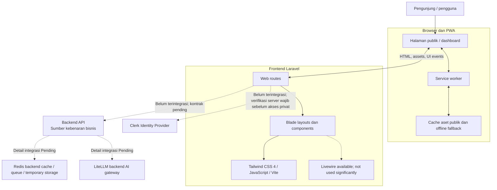

# 02 — Frontend Architecture

## 1. Tujuan dan batas

Frontend iToken adalah aplikasi Laravel 13 yang merender Public Website, Dashboard, dan halaman auth menggunakan Blade. Tailwind CSS 4/Vite membangun assets. Interaksi halaman yang saat ini terimplementasi memakai Vanilla JavaScript ES modules; Livewire 4 tersedia sebagai dependency dan layout directive, tetapi belum mengelola interaksi utama halaman yang diaudit.

Clerk dan Backend API belum terintegrasi. Route Dashboard saat ini mengembalikan UI DEMO tanpa autentikasi dan tanpa data bisnis operasional. Jika integrasi dilakukan, Laravel harus memverifikasi Clerk di server dan menjadi perantara Backend API. Frontend tidak terhubung langsung ke Redis atau LiteLLM. Pembagian stack ada pada `01-technology-stack.md`.

## 2. Komponen sistem

Service worker hanya melayani aset publik/offline fallback. Hubungan API–LiteLLM–Redis adalah tanggung jawab backend dan tidak mendefinisikan permintaan browser.

Fondasi UI saat ini menyediakan route demo `/dashboard/{section?}`. Response memakai `private, no-store`; route belum merepresentasikan autentikasi atau akses privat yang operasional. PWA hanya meng-cache hashed Vite assets dan offline fallback; semua navigasi HTML termasuk dashboard tetap network-only.

Struktur aktual: `routes/web.php` memetakan halaman publik, auth, dan satu route Dashboard dengan parameter section; `resources/views/components/layouts/` menyediakan layout publik dan auth; `resources/views/dashboard/index.blade.php` merender section Dashboard; `resources/views/components/` berisi komponen Blade. `resources/js/app.js` menginisialisasi locale, navigasi, dan modul halaman; modul `dashboard-*.js` serta kamus `*-translations.js` mengelola perilaku/teks fitur terkait. Vite hanya memiliki entry `resources/css/app.css` dan `resources/js/app.js`.

## 3. Lapisan aplikasi

### Browser/PWA

- Merender HTML/CSS/JS yang diberikan Laravel.
- Menjalankan interaksi lokal di browser. Modul UI DEMO tidak mengirim business action ke Laravel/API.
- Menjalankan interaksi client-side yang memang membutuhkan JavaScript.
- Mem-cache hanya static assets publik yang di-allowlist dan offline fallback aman.
- Tidak menjadi otoritas identity, access, wallet, pembayaran, transaksi, atau usage.

### Laravel, Blade, dan Livewire

- Laravel mengelola routing UI dan server rendering. Clerk verification/session dan business API requests belum ada.
- Blade mengatur markup semantik, layout, dan komponen reusable.
- Blade mengeluarkan markup dan data atribut yang dibaca modul Vanilla JavaScript. Livewire tersedia namun belum dipakai signifikan pada halaman yang diaudit.
- Business rules dan data tidak boleh dipindahkan ke component state atau database lokal.
- Update Livewire tidak boleh menurunkan fokus keyboard, label, screen-reader feedback, atau perlindungan CSRF/session yang sudah dikonfigurasi aplikasi.

### Clerk

Clerk ditetapkan sebagai identity provider yang direncanakan, tetapi belum ada SDK/verification/session flow terintegrasi. Auth routes hanya merender UI; POST logout juga menyatakan tidak ada sesi yang diakhiri. Laravel scaffold masih memuat model/migration `users` dan guard Eloquent default, tetapi route auth yang diperiksa tidak menggunakannya. Keputusan penggunaan/penghapusan scaffold perlu ditentukan sebelum integrasi. Jangan menganggap user ID atau status login browser sebagai bukti autentikasi.

### Backend API, LiteLLM, dan Redis

- Backend API adalah satu-satunya jalur aplikasi frontend untuk business data/action.
- LiteLLM adalah gateway/provider AI pada backend. Detail apakah Backend API memanggil LiteLLM langsung, model metadata, error, streaming, dan usage mapping masih **Pending**.
- Redis adalah cache, queue, dan temporary storage pada backend. Data/key/TTL, invalidation, dan efek pada UI harus ditentukan backend; browser tidak menggunakan Redis.
- Laravel tidak mengakses database backend secara langsung.

## 4. Alur konseptual

### Public Website

1. Browser meminta halaman ke Laravel.
2. Blade merender copy statis atau data demo lokal; belum ada data publik yang diambil dari Backend API.
3. Data yang masih mock diberi label `DEMO`; tidak ada statistik/model aktif yang diada-adakan.

### Authenticated Dashboard

1. Route `/dashboard/{section?}` saat ini merender UI DEMO tanpa pemeriksaan auth.
2. Route auth merender halaman UI tanpa memproses credential.
3. Clerk server verification, session, authorization, identity mapping, dan Backend API belum tersedia.
4. Saat integrasi kelak dilakukan, seluruh pemeriksaan harus terjadi di server sebelum data privat dirender.

### Model/AI request pada UI

UI tidak mengirim permintaan model langsung ke provider atau LiteLLM. Bila produk kelak menyediakan playground/request UI, jalurnya, confirmation, secret handling, limit, dan sanitasi harus ditentukan dalam Backend API contract. Playground bukan bagian dari tahap visual utama saat ini.

## 5. Batas data dan keamanan

| Informasi | Pemilik | Aturan frontend |
|---|---|---|
| Identity dan credential | Clerk (rencana) | Belum terintegrasi; jangan menyimpan password atau mempercayai klaim browser |
| Application session | Laravel (target) | Belum tersedia; secure session harus dibuat hanya setelah verifikasi server |
| Business account dan ID mapping | Backend API / kesepakatan backend | Jangan menebak mapping Clerk User ID ke Backend User ID |
| Wallet, billing, transaction, API keys, model, usage | Backend API | Ambil hanya melalui kontrak API; tidak ada local business DB |
| Provider credentials, routing | Backend/LiteLLM | Tidak dikirim ke halaman, bundle Vite, atau browser storage |
| Cache/queue/temp state | Redis/backend | Tidak diakses browser; UI menampilkan hasil hanya jika API menyediakannya |
| Prompt dan completion | Konten sensitif AI | Zero-logging; jangan tampilkan di dashboard history/log/cache |
| Static assets publik | Frontend/Vite | Boleh masuk allowlist PWA setelah direview |

Jangan simpan token/secret di browser storage. Implementasi saat ini menyimpan locale (`itoken-ui-locale`) dan preferensi Dashboard (`itoken.dashboard.*`) di localStorage; profil DEMO memakai `itoken.dashboard.profile.*` termasuk data foto yang dipilih pengguna. Data tersebut bukan identity/session maupun profil server. Hindari data pribadi nyata pada demo. PWA tidak menyimpan response privat, wallet, transaction, API key, usage, prompt, atau completion.

## 6. Error dan state UI

UI DEMO memiliki empty/filter/validation/confirmation state sesuai fiturnya, tetapi belum memiliki loading/error/retry states untuk Backend API. Jangan menutupi kegagalan request dengan mock saat integrasi kelak ditambahkan. Auth state Clerk belum tersedia. Offline hanya berarti aset publik/fallback tersedia; business data membutuhkan koneksi.

## 7. Keputusan yang masih Pending

- Kontrak verifikasi Clerk, SDK/hosted mode, callback, session lifecycle/cookie/logout/revocation.
- Mapping Clerk User ID dan Backend User ID serta provisioning account.
- Backend API base URL, endpoints, schemas, auth antarservice, error, versioning, pagination, timeout/retry, dan data availability per halaman.
- Topology Backend API–LiteLLM dan skema model/error/usage yang diekspos ke frontend.
- Peran detail Redis, TTL, data ownership, invalidation, dan consistency/freshness UI.
- Origin deployment, TLS/proxy boundaries, security headers, dan locale negotiation.
- Detail manifest, service worker scope/cache strategy/update lifecycle dirinci di `08-pwa.md`.
