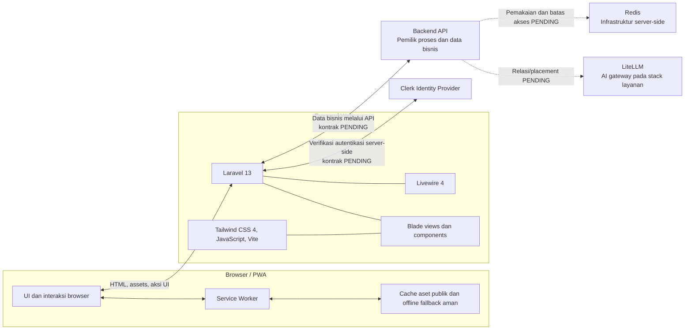

# 09 — Arsitektur Frontend, Integrasi, dan PWA

Dokumen ini menetapkan peran teknologi di sisi frontend dan batas hubungan dengan layanan iToken. Ini bukan spesifikasi Backend API, deployment, atau autentikasi Clerk. Semua detail yang belum disepakati ditandai `PENDING`.

## 1. Gambaran arsitektur

Browser/PWA mengakses aplikasi Laravel. Laravel menyajikan UI dengan Blade dan Livewire, memproses interaksi UI, melakukan verifikasi autentikasi terhadap Clerk di server sesuai kontrak resmi, mengelola secure application session, dan meminta data bisnis hanya melalui Backend API.

Clerk adalah Identity Provider. Backend API memiliki proses dan data bisnis. LiteLLM dan Redis adalah bagian stack layanan/server-side; aplikasi browser tidak mengakses keduanya langsung. Hubungan implementasi Backend API dengan LiteLLM/Redis belum ditetapkan dalam dokumen frontend.

Garis putus-putus menunjukkan bahwa relasi Backend API dengan LiteLLM/Redis belum dikonfirmasi, bukan alur panggilan yang sudah diputuskan. Tidak ada panah browser ke Clerk, LiteLLM, atau Redis yang mengizinkan browser melewati Laravel/Backend API.

## 2. Peran teknologi dan batas tanggung jawab

| Teknologi | Peran dalam iToken | Batas frontend |
|---|---|---|
| Laravel 13 | Aplikasi web, routing halaman, rendering server, secure application session, perantara ke Clerk dan Backend API | Tidak mengakses database bisnis Backend API; tidak membuat sumber kebenaran bisnis lokal |
| Blade | Template halaman, layout, komponen reusable, semantic HTML, dan server-rendered content | Tidak menetapkan aturan bisnis atau menganggap mock sebagai data akun |
| Livewire 4 | Interaksi UI server-driven di dalam aplikasi Laravel, termasuk state UI dan validasi presentasi | Aksi yang membaca/mengubah bisnis harus memakai Backend API setelah kontraknya ada; tidak mengandalkan database lokal |
| Tailwind CSS 4 | Utility styling, responsive states, dan design tokens UI | Tidak membawa state/data atau aturan integrasi |
| JavaScript | Interaksi browser kecil, search/filter lokal pada mock, copy feedback, language selector, dan perilaku PWA | Tidak menyimpan token/secret atau data privat di browser storage/cache |
| Vite | Development server dan bundling aset CSS/JS frontend | Tidak menangani request bisnis atau credential runtime |
| Clerk | Signup, login, logout, email verification, password, dan OAuth | Browser UI mengikuti flow yang disetujui; Laravel tetap memverifikasi autentikasi di server |
| LiteLLM | Komponen AI gateway/model routing yang tercantum di stack layanan | Bukan API publik frontend. UI menerima katalog/status/usage hanya dari Backend API yang disepakati; detail topology `PENDING` |
| Redis | Komponen infrastruktur server-side | Tidak boleh diakses browser. Tujuan, data yang disimpan, TTL, dan relasi dengan Backend API/LiteLLM `PENDING` |
| PWA | Installable app shell, asset caching terbatas, offline fallback, dan update experience | Tidak menyediakan offline access untuk dashboard, API response, ataupun data akun |

## 3. Data flow frontend

### Halaman publik dan data bisnis

1. Browser meminta halaman ke Laravel.
2. Laravel merender Blade; Livewire menangani interaksi yang sesuai di dalam aplikasi.
3. Data bisnis, jika diperlukan, diminta Laravel dari Backend API memakai kontrak yang disepakati.
4. Backend API menjadi sumber kebenaran bagi account bisnis, wallet/kredit, API key, model/pricing, usage, top-up, pembayaran, transaksi, dan billing.
5. Laravel hanya menyajikan data yang boleh dilihat pengguna.

Request/response schema, base URL, service credential, error, pagination, timeout, dan retry Backend API masih `PENDING`. Mock data boleh dipakai untuk UI dan harus terlihat jelas sebagai `DEMO`.

### LiteLLM dan Redis

- LiteLLM berada pada sisi layanan untuk kebutuhan gateway AI sesuai keputusan stack. Frontend tidak memanggil LiteLLM secara langsung dan tidak menerima provider master key.
- Backend API dapat menjadi pemilik integrasi antara UI dan layanan AI, tetapi bentuk integrasi Backend API ↔ LiteLLM, data katalog/status yang diekspos, serta error/usage mapping masih `PENDING`.
- Redis tetap server-side. Frontend tidak mengetahui koneksi, key, command, database/index, atau TTL Redis.
- Apakah Redis dipakai untuk cache, rate limiting, sesi, antrean, atau tujuan lain belum diputuskan. Jangan menyatakan state Redis sebagai fakta UI tanpa endpoint Backend API yang disepakati.
- Tidak ada konfigurasi atau integrasi nyata Clerk, LiteLLM, atau Redis dalam cakupan dokumentasi ini.

## 4. Autentikasi Clerk dan kebutuhan UI

Clerk menangani lifecycle identity: signup, login, logout, verifikasi email, password, dan OAuth. Laravel memverifikasi autentikasi di server dan mengelola secure application session setelah verifikasi berhasil.

UI yang perlu disiapkan:

- Sign in, Sign up, Email verification, Forgot password, Reset password, dan konfirmasi Sign out.
- State loading, validation, invalid credentials, verification pending, resend feedback, provider unavailable, dan sukses hanya berdasarkan hasil integrasi yang nyata.
- Opsi OAuth hanya ditampilkan bila provider telah diaktifkan pada konfigurasi Clerk yang disetujui.
- Branding iToken tetap konsisten walaupun komponen autentikasi hosted/SDK dipakai; mode rendering Clerk masih `PENDING`.
- State terautentikasi tidak boleh dibuat dari query param, localStorage, atau data identitas yang dikirim browser saja.

### Alur konseptual

1. Pengguna memulai flow melalui UI Clerk yang disetujui.
2. Clerk memproses kredensial dan lifecycle identity.
3. Laravel menerima bukti autentikasi melalui mekanisme resmi yang belum ditetapkan dan memverifikasinya di server.
4. Setelah valid, Laravel membuat/mengikat secure application session.
5. Laravel memeriksa sesi pada request privat dan menghubungi Backend API bila data bisnis diperlukan.
6. Logout mengakhiri application session dan mengikuti mekanisme Clerk yang disepakati.

Jangan mengasumsikan JWT, cookie/token format, session exchange, refresh, claim, SDK, callback path, atau revoke behavior sebelum kontrak Clerk ditetapkan. Tidak boleh ada tabel `users` lokal untuk autentikasi iToken dan password tidak boleh disimpan di frontend.

## 5. PWA

PWA wajib mencakup web manifest, service worker, prompt instalasi yang tidak mengganggu, offline fallback informatif, status koneksi, dan alur update. PWA adalah cara memasang dan memuat shell aplikasi; ia tidak menjadikan data privat tersedia offline.

### Web manifest

Manifest perlu menjelaskan identitas iToken dan bagaimana aplikasi dibuka dari home screen. Properti yang harus dikonfirmasi saat implementasi:

| Properti | Kebutuhan | Status |
|---|---|---|
| `name`, `short_name`, `description` | Nama aplikasi iToken dengan bahasa default `id` | Nilai final dan panjang `short_name` `PENDING` |
| `lang`, `dir` | Locale default Bahasa Indonesia dan arah kiri-ke-kanan | `lang` manifest yang dipilih `PENDING`; UI locale tetap mendukung `id`, `en`, `zh_CN` |
| `start_url`, `scope` | Membuka public app shell pada path yang disetujui | Path production `PENDING`; jangan menetapkan path dashboard sebagai offline start |
| `display` | Mode install yang sesuai pengalaman aplikasi | Nilai final `standalone`/opsi lain `PENDING` |
| `theme_color`, `background_color` | Mengikuti light theme iToken | Nilai warna final mengikuti design tokens |
| `icons` | Ikon aplikasi untuk ukuran dan maskable purpose yang dibutuhkan browser | Sumber file, ukuran, purpose dan desain final `PENDING` |

Manifest tidak boleh mencantumkan shortcut atau start destination privat seolah-olah tersedia offline.

### Service worker dan cache

- Service worker hanya boleh menyimpan static assets publik yang tercantum pada allowlist dan satu offline fallback aman.
- Kandidat aset: versi build CSS/JS, font publik lokal, ikon, manifest, dan fallback. Daftar final harus direview saat implementasi.
- Jangan cache halaman dashboard privat, Clerk credential/session, Backend API response, wallet/kredit, transaksi, API key, usage, prompt/completion, token, atau secret.
- Jangan memakai cache runtime generik untuk navigation/API. Fetch berisi data pribadi harus dilewatkan tanpa menyimpan response.
- Tidak boleh ada `localStorage`, `sessionStorage`, Cache Storage, atau IndexedDB untuk credential/token sensitif.
- Preferensi locale non-sensitif boleh disimpan untuk kenyamanan UI; jangan campur dengan session/identity.
- Strategi fetch/cache, cache naming/versioning, invalidation, service worker scope, dan cleanup policy `PENDING`. Pilih strategi yang tidak pernah menulis respons privat ke cache.

### Instalasi

- Tampilkan affordance instalasi hanya ketika browser menyatakan installability/menyediakan event yang sesuai.
- Jangan memaksa prompt atau menghalangi penggunaan situs bila install tidak didukung.
- Simpan status dismiss hanya sebagai preferensi non-sensitif jika diperlukan.
- Berikan petunjuk manual yang aksesibel untuk browser/platform yang tidak menyediakan prompt; detail copy/platform `PENDING`.

### Offline fallback dan koneksi

- Offline fallback menyatakan koneksi diperlukan untuk memuat akun dan data terbaru.
- Fallback hanya berisi konten statis publik; tidak menampilkan snapshot dashboard, saldo, transaksi, usage, API key, atau konten AI.
- Tampilkan state koneksi pulih secara ringkas, tanpa mengklaim sinkronisasi data sebelum request berhasil.
- Jika form belum terkirim saat koneksi terputus, jangan menyatakan aksi berhasil; perilaku retry dan penyimpanan draft `PENDING` per jenis form.

### Pembaruan aplikasi

- Service worker baru harus memberi tahu UI bahwa versi baru tersedia.
- Pengguna mendapat aksi update yang jelas; jangan melakukan reload yang menghilangkan perubahan form tanpa penjelasan.
- Setelah update, UI memuat aset versi baru dan memastikan cache lama yang dikelola aplikasi dibersihkan sesuai kebijakan.
- Copy prompt, aktivasi worker, reload timing, dan strategi saat ada state UI belum disepakati (`PENDING`).

## 6. Localization

- `id` adalah bahasa default, `en` English, dan `zh_CN` Simplified Chinese.
- Semua label, pesan validasi, empty/loading/error/success state, dialog, install/offline/update messages harus tersedia dalam ketiga bahasa.
- Nama model/provider, identifiers, kode, dan nilai teknis tidak diterjemahkan.
- Format angka, tanggal, dan mata uang mengikuti locale aktif menggunakan data yang sumber dan currency-nya sudah ditetapkan.
- Tag `lang` dokumen untuk Simplified Chinese dipetakan ke tag HTML yang sesuai (`zh-CN`); identifier produk `zh_CN` tetap dipakai dalam katalog locale.
- Implementasi UI saat ini mengganti bahasa di browser dan menyimpan pilihan locale sebagai preferensi non-sensitif. Ini bukan credential maupun application session.
- Apakah locale perlu dinegosiasikan server-side, dibawa URL, atau disinkronkan ke account preference masih `PENDING`. Jangan menyimpan locale bersama credential.

## 7. Batas keamanan dan privasi

- Browser bukan otoritas autentikasi, authorization, saldo, transaksi, atau status pembayaran.
- Laravel memverifikasi identitas melalui Clerk sesuai kontrak dan melindungi session.
- Laravel berbicara ke Backend API; akses database Backend API secara langsung dilarang.
- Browser tidak terhubung ke Redis atau LiteLLM dan tidak menerima secret provider.
- Jangan cache dashboard privat atau API response.
- Jangan log, menyimpan, atau menampilkan prompt/completion. Pertahankan zero-logging untuk keduanya.
- Status Paid/Success hanya boleh tampil jika ada data integrasi nyata; mock harus ditandai DEMO dan tidak boleh menyerupai transaksi sungguhan.

## 8. Keputusan final dan `PENDING`

### Final

- Stack resmi: Laravel 13, Livewire 4, Blade, Tailwind CSS 4, JavaScript, Vite, Clerk, LiteLLM, Redis, dan PWA.
- UI memakai light theme dan mendukung `id` (default), `en`, `zh_CN`.
- Laravel merender UI, memverifikasi autentikasi Clerk di server sesuai kontrak, mengelola secure application session, dan mengakses data bisnis melalui Backend API saja.
- Clerk memiliki identity lifecycle; tidak ada password atau tabel users lokal untuk auth.
- Backend API memiliki proses/data bisnis; browser tidak terhubung ke database, LiteLLM, atau Redis.
- PWA hanya cache static assets publik dan offline fallback aman; data privat dan konten AI tidak di-cache.
- Prompt dan completion tidak boleh disimpan (zero-logging).

### `PENDING`

- Clerk SDK/hosted mode, metode server verification, callback, session lifecycle, cookie attributes, expiry, logout/revocation, environment configuration.
- Pemetaan Clerk User ID ↔ Backend User ID dan account provisioning/linking.
- Backend API base URL, endpoint, request/response, authorization, error, versioning, pagination, retry, dan data yang dibutuhkan halaman.
- Apakah Backend API memakai LiteLLM secara langsung, service boundary, model metadata/status/usage mapping, serta error/fallback representation.
- Tujuan Redis, pemilik data/key, TTL, invalidation, dan relasi dengan Backend API/LiteLLM.
- PWA manifest values/icons, start URL/scope, service worker allowlist/cache strategy, offline copy, install prompt behavior, dan update lifecycle.
- Locale persistence/server negotiation, deployment origin/TLS, serta batas metadata log yang kompatibel dengan zero-logging.
